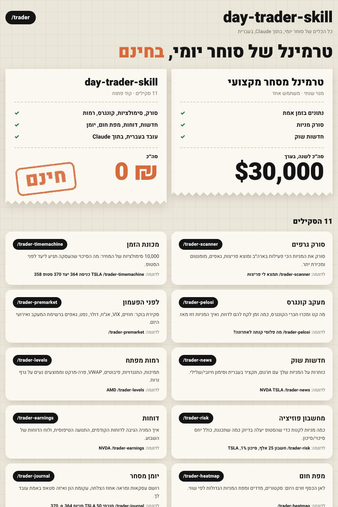
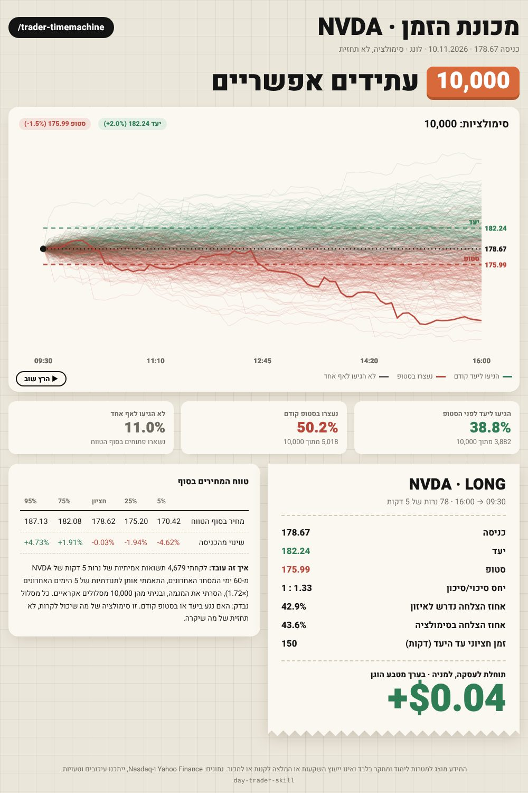
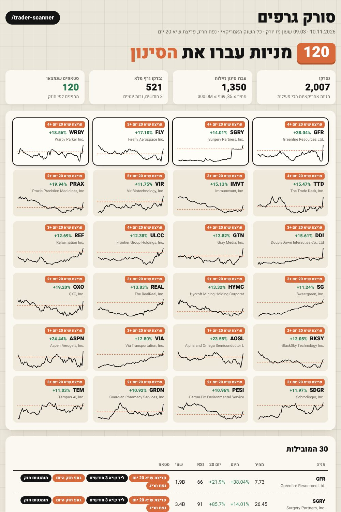
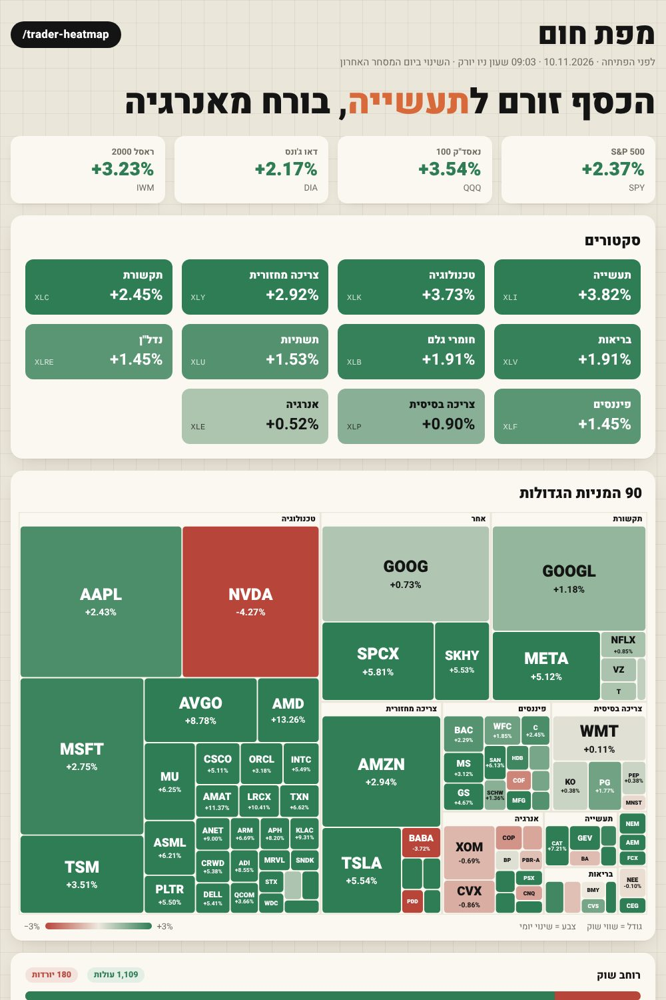
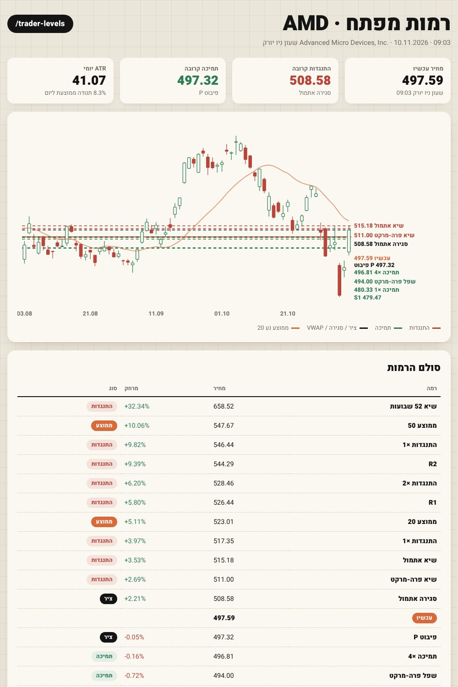
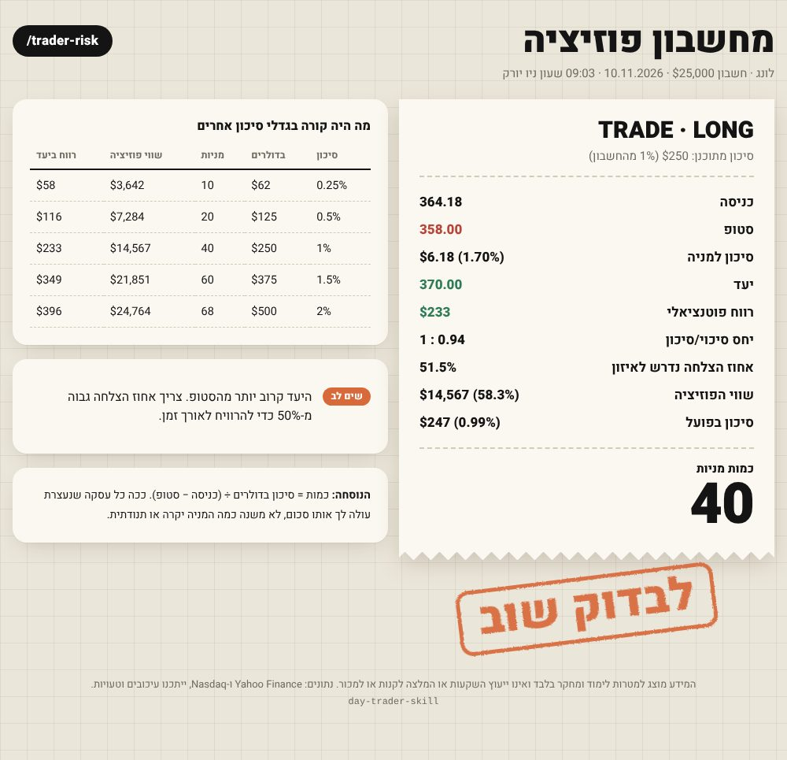
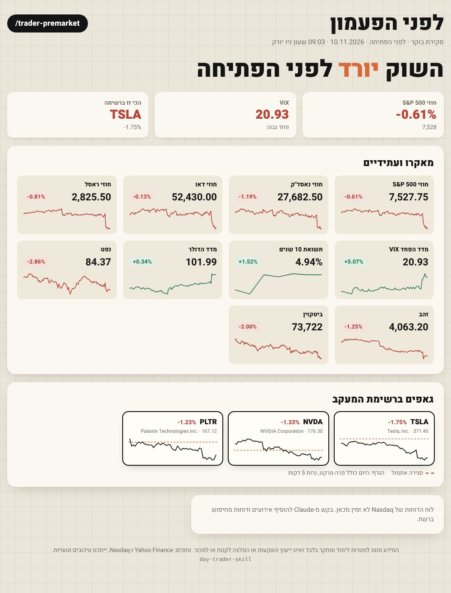

<div dir="rtl">

# day-trader-skill

**11 סקילים של סוחר יומי, בתוך Claude, בעברית. קוד פתוח, בחינם.**

כל סקיל מושך נתוני שוק אמיתיים, מחשב, ומחזיר דף מעוצב בסגנון "קבלה": נייר שמנת, משבצות, חותמות כתומות.



## הסקילים

| פקודה | מה זה עושה |
|---|---|
| `/trader` | התפריט הראשי, מנתב לסקיל הנכון |
| `/trader-scanner` | **סורק גרפים**: סורק את המניות הפעילות בארה״ב ומוצא פריצות, גאפים, מומנטום, מכירת יתר, חציית ממוצעים, התכווצות ונפח חריג |
| `/trader-timemachine` | **מכונת הזמן**: 10,000 סימולציות מונטה קרלו מתשואות אמיתיות. מה הסיכוי שהעסקה תגיע ליעד לפני הסטופ |
| `/trader-pelosi` | **מעקב קונגרס**: עסקאות שדיווחו חברי קונגרס, עיכוב הדיווח, ואיך המניות זזו מאז |
| `/trader-premarket` | **לפני הפעמון**: חוזים, VIX, אג״ח, דולר, נפט, זהב, ביטקוין, גאפים ואירועי היום |
| `/trader-news` | **חדשות שוק**: כותרות עם תרגום, תקציר בעברית וסימון חיובי/שלילי |
| `/trader-levels` | **רמות מפתח**: תמיכות, התנגדויות, פיבוטים, VWAP, פרה-מרקט וממוצעים על גרף נרות |
| `/trader-risk` | **מחשבון פוזיציה**: כמה מניות לקנות כדי שהסטופ יעלה בדיוק כמה שתכננת |
| `/trader-earnings` | **דוחות**: איך המניה הגיבה לדוחות הקודמים, התנועה הטיפוסית, ולוח הדוחות |
| `/trader-heatmap` | **מפת חום**: סקטורים, מדדים, מפת המניות הגדולות ורוחב שוק |
| `/trader-journal` | **יומן מסחר**: אחוז הצלחה, פקטור רווח, עקומת הון ומה עובד לך |

אפשר גם לכתוב רגיל: "תמצא לי פריצות", "מה הסיכוי ש-TSLA תגיע ל-370 לפני 358", "מה פלוסי קנתה".

## איך זה נראה

| מכונת הזמן | סורק גרפים |
|---|---|
|  |  |
| **מפת חום** | **רמות מפתח** |
|  |  |
| **מחשבון פוזיציה** | **לפני הפעמון** |
|  |  |

(צילומי מסך מנתוני שוק אמיתיים מ-10.11.2026. יומן המסחר בצילום הוא דוגמה.)

## התקנה

### ב-Claude (אפליקציה או אתר)

1. הורד את קבצי ה-zip מהתיקייה [`dist/`](dist/), אחד לכל סקיל.
2. ב-Claude: **Settings → Capabilities → Skills → Upload skill**, והעלה כל zip.
3. ודא שהרצת קוד (code execution) פעילה, ושיש לה גישה לרשת לדומיינים:
   `query1.finance.yahoo.com`, `query2.finance.yahoo.com` (ובאופן אופציונלי `api.nasdaq.com`).
4. כתוב `/trader` בצ'אט חדש.

### ב-Claude Code

```
/plugin marketplace add tallomovsky-lgtm/Marketmaster
/plugin install day-trader-skill@marketmaster
```

או בלי פלאגין: העתק את התיקיות שבתוך `skills/` אל `~/.claude/skills/`.

## מאיפה הנתונים

- **מחירים, גרפים, חדשות, סורקים**: Yahoo Finance (חינם, ייתכן עיכוב).
- **רשימת כל המניות, לוח דוחות**: Nasdaq, כשהוא זמין. Nasdaq חוסם חלק מהלקוחות האוטומטיים, ואז הסורק עובד על המניות הפעילות מ-Yahoo (בערך 2,000), ו-Claude משלים את לוח הדוחות מחיפוש ברשת.
- **עסקאות קונגרס**: אין API פתוח וחינמי, אז Claude אוסף אותן בחיפוש ברשת (Capitol Trades, Quiver, אתרי הגילוי הרשמיים) והסקיל מעבד ומוסיף את תנועת המחיר.
- **Interactive Brokers**: אם החיבור ל-IBKR פעיל, Claude יכול למשוך דרכו נרות ולהעביר לסקריפטים עם `TRADER_DATA` (הפורמט מתועד ב-`shared/tradelib.py`).

## פיתוח

- `shared/tradelib.py`: הנתונים, החישובים והעיצוב, משותפים לכל הסקילים.
- `shared/skills_src.py` + `shared/COMMON.md`: המקור של כל קבצי `SKILL.md`.
- `python3 build.py`: מעתיק את `tradelib.py` לכל סקיל, כותב את קבצי `SKILL.md`, ובונה את קבצי ה-zip ב-`dist/`.
- Python 3.11 ומעלה (נבדק על 3.11 ו-3.13), ספרייה סטנדרטית בלבד. אין מה להתקין.

## חשוב

הכלים האלה נועדו ללימוד ולמחקר. הם לא ייעוץ השקעות ולא המלצה לקנות או למכור. סימולציה היא לא תחזית, ומה שקרה בעבר לא מבטיח את העתיד.

</div>
